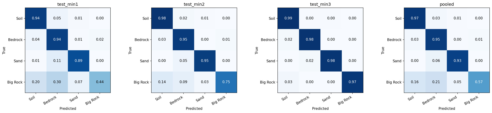

# Mars Rover Terrain Segmentation

Pixel-level terrain classification (Soil, Bedrock, Sand, Big Rock) on Mars rover images, using the
[AI4Mars](https://huggingface.co/datasets/hassanjbara/AI4MARS) dataset. The repo contains the full
PyTorch pipeline: data audit, preprocessing, training, and evaluation. All training ran on a single T4 GPU.

**Final model:** an ensemble of two U-Nets with ImageNet-pretrained ResNet34 encoders reaches
**0.745 mIoU** on the official test splits (a U-Net trained from scratch reaches 0.726).

## Results

| Model | Val mIoU | Test mIoU | Soil | Bedrock | Sand | Big Rock |
|---|---|---|---|---|---|---|
| U-Net (from scratch) | 0.742 | 0.726 | 0.944 | 0.866 | 0.890 | 0.203 |
| U-Net, ResNet34 pretrained | 0.855 | 0.740 | 0.949 | 0.880 | 0.915 | 0.217 |
| + augmentation | 0.855 | 0.734 | 0.951 | 0.878 | 0.920 | 0.187 |
| **Ensemble of the two pretrained models** | - | **0.745** | 0.953 | 0.883 | 0.921 | 0.223 |

Test = mean over `test_min1/2/3`; per-class columns are test IoU. These three splits are the **same 322 images**
with labels filtered at three annotator-agreement levels, so they are one test set, not three.



## Key findings

- **Validation overstates test performance.** Validation shares scenes with the training data. Big Rock IoU is
  0.62 on validation but 0.22 on test, so model selection on validation alone would have been misleading.
- **Big Rock on test is a precision problem** (precision 0.23, recall 0.72): the model over-predicts the rare class.
- **Model differences are small relative to noise.** A paired bootstrap over test images gives
  pretrained vs. scratch +0.021 mIoU (95% CI -0.008 to +0.066) and ensemble vs. single model +0.007 (CI +0.0004 to +0.024).
- **Augmentation reduced overfitting** (train/val loss 0.015/0.118 down to 0.074/0.087) without improving test mIoU.
- **The source labels already comply with the rover/30 m exclusions.** Applying them changed 0 pixels on all
  16,064 usable train rows and all test rows, so the step is kept as an enforced, tested guarantee.
- **Exploratory:** a negative bias on the Big Rock logit raised its precision from 0.23 to 0.58 and mIoU of the
  pretrained model from 0.740 to 0.793 when tuned on all test images (in-sample). A half-split estimate gave
  +0.017, so this is not part of the headline result.

## Pipeline

1. **Data audit:** 19,096 samples checked for corrupt images, missing masks and shape mismatches. Found 3 corrupt
   images, 2,066 unlabeled train rows and 1 labeled row without a range mask.
2. **Preprocessing:** rover-body and beyond-30 m pixels set to the ignore label (255) at full resolution; labels
   resized with nearest-neighbor, images with bilinear, at 512x512; 163 fully ignored rows dropped.
3. **Split:** blocks of 100 consecutive rows, 90/10 (`data/splits.json`, seed 42): 14,312 train / 1,589 val.
   The dataset has no sequence IDs, so blocks reduce near-duplicate leakage.
4. **Models:** U-Net from scratch (7.8M parameters); U-Net with an ImageNet ResNet34 encoder (24.4M,
   `segmentation_models_pytorch`).
5. **Training:** AdamW, cosine schedule, mixed precision, cross-entropy with `ignore_index=255`, 15 epochs,
   batch size 8, resumable checkpoints (about 2.3 h per run on a Kaggle T4).
6. **Evaluation:** confusion-matrix mIoU with 255 ignored, per-class IoU, Big Rock precision/recall, paired
   bootstrap over test images.

## Repository structure

```
├── configs/
├── data/splits.json          # fixed train/val row indices
├── notebooks/
│   ├── 01_dataset_exploration.ipynb
│   ├── 02_data_preprocessing.ipynb
│   ├── 03_baseline.ipynb
│   ├── 04_model_experiments.ipynb
│   └── 05_evaluation.ipynb
├── results/                  # metrics, histories, configs, figures (no weights)
├── src/
│   ├── data/                 # preprocessing, dataset loaders, augmentation
│   ├── models/               # U-Net, model factory
│   ├── training/             # trainer, losses, experiment runner
│   ├── evaluation/           # metrics, ensembling, bootstrap analysis
│   └── utils/                # seeding/device, visualization
└── requirements.txt
```

## Quickstart

```bash
git clone https://github.com/Agontuk19/mars-rover-segmentation.git
cd mars-rover-segmentation
pip install -r requirements.txt
```

Run one experiment (needs a CUDA GPU; 512x512 at batch size 8 ran on a 16 GB T4):

```python
from src.data.dataset import load_raw_datasets, load_splits
from src.training.run import run_experiment
from src.utils.common import get_device

raw = load_raw_datasets()                      # downloads AI4Mars from Hugging Face
splits = load_splits("data/splits.json")
cfg = {"name": "unet_resnet34_pretrained", "model": "smp_unet", "encoder": "resnet34",
       "encoder_weights": "imagenet", "loss": "ce", "epochs": 15, "lr": 3e-4}
run_experiment(cfg, raw, splits, get_device(), "outputs/experiments")
```

Evaluation and ensembling: `notebooks/05_evaluation.ipynb`. It loads `checkpoints/<name>/best.pt`;
model weights are not stored in the repo.

## Limitations

- One training seed per model, and a 322-image test set: differences below about 0.01 mIoU are not reliable.
- Models and the ensemble were compared on the test set, so test numbers are slightly optimistic.
- Big Rock remains weak (IoU about 0.22); the validation/test label mismatch limits what training changes can fix.

## Dataset

AI4Mars (NASA JPL), loaded through the Hugging Face mirror `hassanjbara/AI4MARS`: 16,064 labeled training
images and 322 test images with four terrain classes.
